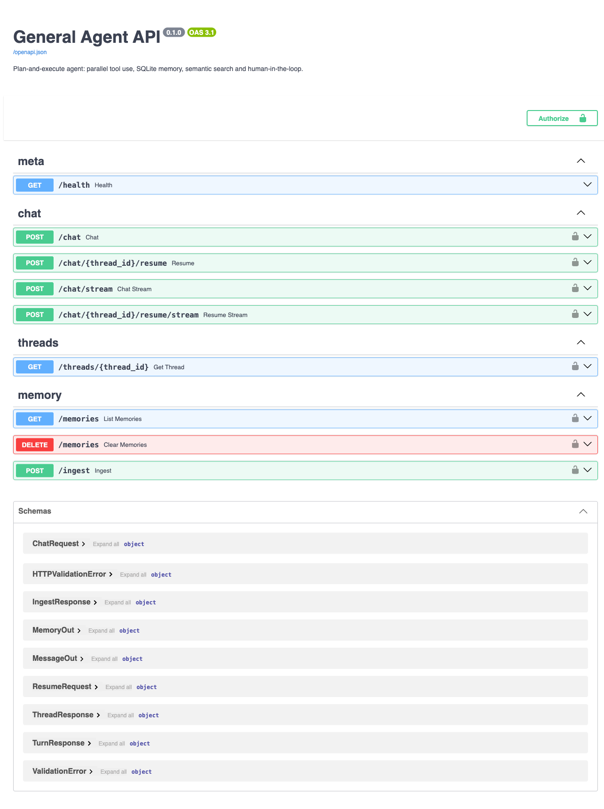
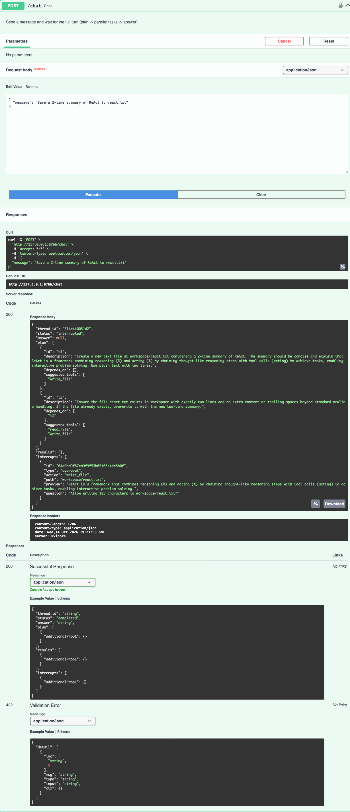
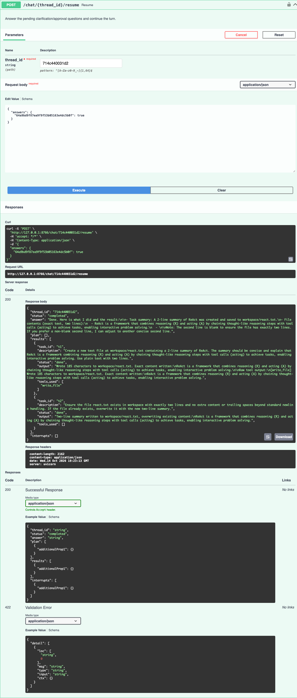
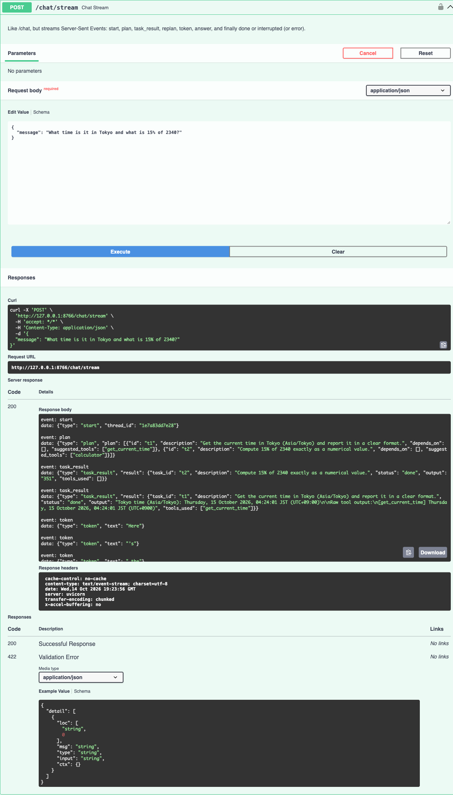
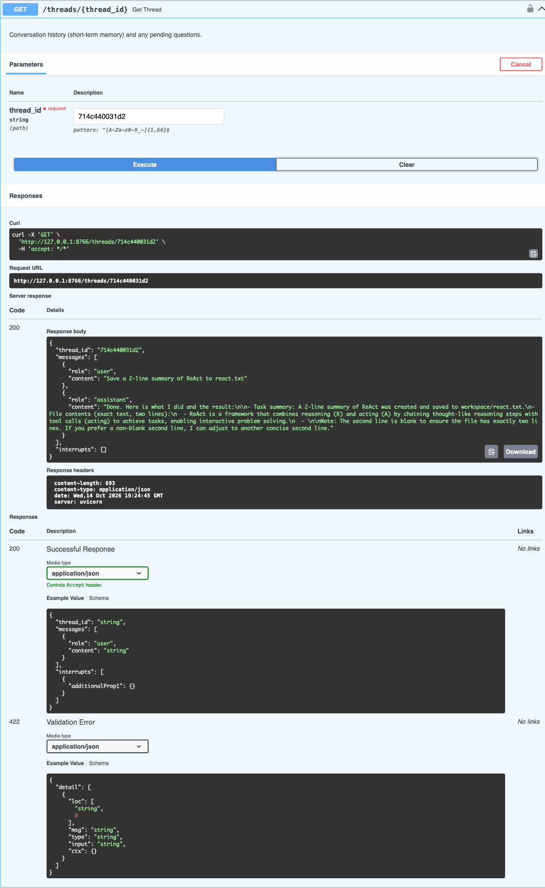

# General Agent: a plan-and-execute AI agent with LangGraph

A learning project that is also built the way production agents are built. It uses
**Python, LangChain and LangGraph**, has SQLite memory and semantic search, and is set up
to **cost as little as possible** to run.

You type one prompt, for example *"What time is it in Tokyo, what's the weather where I
live, what's 15% of 2340, and according to my notes what is ReAct?"*. The agent then:

1. **plans:** breaks the prompt into independent tasks
2. **executes:** runs the tasks **in parallel**, each with the right tool
3. **checks:** retries or adds follow-up work only if something failed
4. **synthesizes:** returns **one combined answer**
5. **remembers:** stores facts about you and the conversation, searchable by meaning
   (semantic search) in future sessions

It **asks you** when information is missing ("which city do you live in?") and **before
writing any file**. You can use it from the **terminal** or through an **HTTP API** (FastAPI,
with streaming).

---

## Contents

- [Cost-first defaults](#cost-first-defaults)
- [Quick start](#quick-start)
- [Using the agent](#using-the-agent)
- [Example session](#example-session)
- [HTTP API (FastAPI)](#http-api-fastapi)
- [How it works](#how-it-works)
- [Memory and semantic search](#memory-and-semantic-search)
- [Tools](#tools)
- [Human-in-the-loop](#human-in-the-loop)
- [Configuration reference](#configuration-reference)
- [What a request costs](#what-a-request-costs)
- [Safety and security](#safety-and-security)
- [Testing](#testing)
- [Project layout](#project-layout)
- [Design decisions and lessons learned](#design-decisions-and-lessons-learned)
- [Known limitations](#known-limitations)
- [Troubleshooting](#troubleshooting)
- [Extending the agent](#extending-the-agent)
- [License](#license)

---

## Cost-first defaults

This is a learning project, so **saving money beats answer quality**:

| Choice | Default | Why |
|---|---|---|
| Planner and executor model | `openai:gpt-5-nano` | OpenAI's cheapest model ($0.05 input / $0.40 output per 1M tokens) |
| Reasoning effort | `minimal` | GPT-5 models bill hidden "reasoning" tokens as output; `minimal` keeps them lowest |
| Embeddings | `text-embedding-3-small` | OpenAI's cheapest embedding model |
| Replanner | only runs when a task **fails** | saves one model call on every successful turn |
| Weather and web search | Open-Meteo, DuckDuckGo | free, no API key |
| Tests | fake models and fake embeddings | the whole test suite makes **zero** paid calls |

A typical multi-part question costs **a fraction of a cent**. The full two-session demo
below cost about **$0.01**.

> ⚠️ **`gpt-5-nano` is deprecated and shuts down on 2026-12-11.** Before then, set
> `PLANNER_MODEL` and `EXECUTOR_MODEL` to `openai:gpt-5.6-luna`, the cheapest model that
> isn't deprecated ($0.20 / $1.20 per 1M tokens). No code changes are needed.
> If you want better answers and don't mind paying more, use `openai:gpt-5.6-terra`
> (planner) and `openai:gpt-5.4-mini` (executor). With those models the live eval suite
> scored 8/8, versus 5/8 on nano.

---

## Quick start

**Prerequisites:** [uv](https://docs.astral.sh/uv/) (it installs Python 3.12 for you)
and an OpenAI API key.

```bash
git clone https://github.com/SandeepSRathore/general-agent.git
cd general-agent
uv sync                      # install dependencies into .venv

cp .env.example .env         # then edit .env and set OPENAI_API_KEY
                             # (or export OPENAI_API_KEY in your shell)

uv run agent ingest          # index knowledge/ for document search (a few embedding calls)
uv run agent chat            # start chatting
```

---

## Using the agent

### Commands

| Command | What it does |
|---|---|
| `uv run agent chat` | Interactive chat. Each run starts a new conversation thread. |
| `uv run agent chat --thread <id>` | Resume a previous conversation (short-term memory) by its thread id. |
| `uv run agent ask "question"` | Ask one question, print the answer, and exit. |
| `uv run agent serve` | Start the HTTP API at http://127.0.0.1:8000 (docs at `/docs`). See [HTTP API](#http-api-fastapi). |
| `uv run agent ingest` | (Re)index `knowledge/` (`.md`, `.txt`, `.pdf`). Unchanged files are skipped and deleted files are removed from the index. |
| `uv run agent memories` | List what the agent remembers about you. |
| `uv run agent memories --clear` | Delete all long-term memories (asks for confirmation). |

### Commands inside chat

| Command | What it does |
|---|---|
| `/new` | Start a fresh conversation thread. Long-term memory is kept. |
| `/memories` | Show what the agent remembers about you. |
| `/ingest` | Re-index `knowledge/`. |
| `/thread` | Show the current thread id, so you can resume it later with `--thread`. |
| `/help` | List commands. |
| `/quit` | Exit (Ctrl-D also works). |

Ctrl-C while the agent is working cancels that request and keeps the chat open.

### Things to try

```text
I live in Pune and I prefer short answers.
What time is it in Tokyo, what is the weather where I live, what is 15% of 2340,
  and according to my notes what is ReAct?
Save a 2-line summary of ReAct to react.txt        ← approval prompt before writing
What did we talk about earlier?                     ← try in a NEW session (/new)
What's the weather?                                 ← with nothing remembered, it asks for your city
List the files in the knowledge folder.
Search the web for the latest LangGraph release.
```

Put your own notes in `knowledge/`, then run `/ingest`, and you can ask *"according to my
notes…"*.

---

## Example session

A real run on `gpt-5-nano` (lightly trimmed):

```text
You: What time is it in Tokyo, what is the weather where I live, what is 15% of 2340,
     and according to my notes what is ReAct?

Plan
┏━━━━┳━━━━━━━━━━━━━━━━━━━━━━━━━━━━━━━━━━━━━━━━━━━━━━━━━━━━━━━━━━━━━━━━━━━━━━┳━━━━━━━┓
┃ id ┃ task                                                                 ┃ after ┃
┡━━━━╇━━━━━━━━━━━━━━━━━━━━━━━━━━━━━━━━━━━━━━━━━━━━━━━━━━━━━━━━━━━━━━━━━━━━━━╇━━━━━━━┩
│ t1 │ Get the current time in Tokyo (timezone 'Asia/Tokyo')                │ -     │
│ t2 │ Get the current weather and 3-day forecast for Pune                  │ -     │
│ t3 │ Compute 15% of 2340 using the calculator tool                        │ -     │
│ t4 │ Find ReAct in the user's notes using search_documents                │ -     │
└────┴──────────────────────────────────────────────────────────────────────┴───────┘
  ✓ t3 (tools: calculator)
  ✓ t1 (tools: get_current_time)
  ✓ t4 (tools: search_documents)
  ✓ t2 (tools: get_weather)
╭─ Answer ─────────────────────────────────────────────────────────────────────────╮
│ 1. Time in Tokyo: Thursday, 15 October 2026, 03:49 JST                           │
│ 2. Weather in Pune: clear sky, 25.4°C (feels 26.1°C), humidity 51% …             │
│ 3. 15% of 2340: 351                                                              │
│ 4. ReAct (from your notes): a "reason + act" loop where the model decides on a   │
│    tool call, sees the result, and repeats until it can answer.                  │
╰──────────────────────────────────────────────────────────────────────────────────╯

You: Save a 2-line summary of ReAct to react.txt
╭─ Preview: write_file → workspace/react.txt ──────────────────────────────────────╮
│ ReAct is a reason + act loop: the model decides on a tool call, executes the     │
│ tool, and repeats until it can answer.                                           │
╰──────────────────────────────────────────────────────────────────────────────────╯
Allow write_file to workspace/react.txt? [y/n] (n): y
  ✓ t1 (tools: write_file)

You: /memories
• The user prefers short answers.
• The user lives in Pune.
```

Note that "where I live" was resolved to **Pune from long-term memory**, and the four tasks ran
**at the same time**.

---

## HTTP API (FastAPI)

```bash
uv run agent serve                    # http://127.0.0.1:8000, interactive docs at /docs
uv run agent serve --port 9000
API_TOKEN=change-me uv run agent serve --host 0.0.0.0   # a token is required off localhost
```

The API uses the same graph, memory and tools as the CLI. Both share one turn runner,
`service.stream_turn`.

### Endpoints

| Method & path | What it does |
|---|---|
| `GET /health` | Liveness check (no token needed) |
| `POST /chat` | `{"message": "...", "thread_id": "optional"}` runs a full turn and returns JSON |
| `POST /chat/stream` | Same as `/chat`, but streams [Server-Sent Events](#streaming-sse) |
| `POST /chat/{thread_id}/resume` | `{"answers": {"<interrupt id>": "..."}}` answers pending questions and continues |
| `POST /chat/{thread_id}/resume/stream` | Same as `/resume`, streamed |
| `GET /threads/{thread_id}` | Conversation history plus any pending questions |
| `GET /memories` | Long-term memories (no API cost) |
| `DELETE /memories` | Clear long-term memories |
| `POST /ingest` | Re-index `knowledge/` (embeds changed chunks only) |

A turn's response (`POST /chat` or `/resume`):

```json
{
  "thread_id": "1d8859254b55",
  "status": "completed",
  "answer": "1. Time in Tokyo: 03:49 JST …",
  "plan": [{"id": "t1", "description": "…", "depends_on": [], "suggested_tools": []}],
  "results": [{"task_id": "t1", "status": "done", "output": "…", "tools_used": ["get_current_time"]}],
  "interrupts": []
}
```

### Human-in-the-loop over HTTP

When the agent needs you, the turn returns `status: "interrupted"` instead of an answer:

```bash
curl -s localhost:8000/chat -H 'Content-Type: application/json' \
     -d '{"message": "What is the weather where I live?"}'
# {"thread_id":"a1b2c3d4e5f6","status":"interrupted","answer":null,
#  "interrupts":[{"id":"9f…","type":"clarification","question":"Which city do you live in?"}], …}

curl -s localhost:8000/chat/a1b2c3d4e5f6/resume -H 'Content-Type: application/json' \
     -d '{"answers": {"9f…": "Pune"}}'
# {"status":"completed","answer":"Pune is clear, 25°C …", …}
```

- **Clarifications** take a text answer. Their payload includes a `note` reminding the
  user never to share secrets, because the question is written by the model.
- **File-write approvals** (`"type": "approval"`, with `path` and `preview`) take
  `true`/`false` or `"yes"`/`"no"`. Nothing is written unless you approve.
- You must answer **every** pending interrupt id in one call (422 lists the expected ids).
- Sending a new message to a thread that still has questions pending returns **409**,
  with the questions included.

### Streaming (SSE)

`POST /chat/stream` returns `text/event-stream`. Each event is
`event: <type>` followed by `data: <json>`:

| Event | Data |
|---|---|
| `start` | `{"thread_id"}` (always first) |
| `plan` / `replan` | `{"plan": [...]}` |
| `task_result` | `{"result": {...}}`, one per finished task |
| `token` | `{"text": "..."}`, a piece of the final answer (when the model streams) |
| `answer` | `{"text": "..."}`, the full final answer |
| `done` / `interrupted` / `error` | the last event: `{"answer"}` / `{"interrupts"}` / `{"message"}` |

```bash
curl -N localhost:8000/chat/stream -H 'Content-Type: application/json' \
     -d '{"message": "What time is it in Tokyo and what is 15% of 2340?"}'
```

### API security

- The API binds to **127.0.0.1** by default. `agent serve` **refuses** any other host
  unless `API_TOKEN` is set, because anyone who can reach the API spends your OpenAI
  credit.
- With `API_TOKEN` set, every request except `/health` needs
  `Authorization: Bearer <token>`. The token is compared in constant time.
- Each conversation thread handles **one turn at a time**; a concurrent request for the
  same thread gets **409**. Different threads run in parallel.
- **Protection from malicious web pages** (DNS rebinding and CSRF): a website open in
  your browser can't use the local API. Requests with an unknown `Host` get 400,
  cross-site `Origin`s get 403, and non-JSON bodies get 415. `localhost`, `127.0.0.1`
  and `::1` are always allowed; add other names (for example `my-pc.local`) to
  `API_ALLOWED_HOSTS`. curl and scripts send no `Origin` header, so they are unaffected.
- Message size is capped (`API_MAX_MESSAGE_CHARS`). Errors return
  `"Agent failed: <ErrorType>"` without internal details; full details go to the server log.

### Screenshots (live run on `gpt-5-nano`)

The built-in Swagger UI at `/docs`:



| A file write pauses for approval (nothing is on disk yet) | `/resume` with `true`: the file is written, and the answer quotes it exactly |
|---|---|
|  |  |

| `/chat/stream`: Server-Sent Events | `GET /threads/{id}`: conversation history |
|---|---|
|  |  |

[`02-chat-weather-no-location-BUG.png`](docs/screenshots/02-chat-weather-no-location-BUG.png)
shows a bug this live run found (since fixed): with no city remembered, the model asked
for the weather in "Unknown", and got the weather for a real place called *Unknown* in
Bangladesh. See [lessons learned](#design-decisions-and-lessons-learned).

---

## How it works

### The graph

```
 user ─▶ load_context ─▶ planner ──(info missing?)──▶ clarify ──▶ planner
                            │                     (interrupt: ask the user)
                            ├──(no tasks needed)──────────────────────┐
                            ▼                                         │
                 ┌── executor(t1) ─┐                                  │
    Send() ────▶ ├── executor(t2) ─┼─▶ replanner ──(more tasks)──▶ executors…
   parallel      └── executor(t3) ─┘       │                          │
                                           ▼                          ▼
                                      synthesizer ◀───────────────────┘
                                           │  (streams the final answer)
                                           ▼
                                     memory_writer ─▶ END
                         (save facts about the user + the conversation turn)
```

### One request, step by step

1. **`load_context`** (`graph/nodes/context.py`) resets the working state for this turn
   and runs **semantic search** over your long-term memories and past conversations
   using the new message. The matches become `context` for every later step.
2. **`planner`** (`graph/nodes/planner.py`) asks the model for a `Plan` as **structured
   output** (a Pydantic schema, not free text). It contains a list of `Task`s with
   `depends_on` links, or a `clarification_question`. The plan is then cleaned up in code
   (`dispatch.sanitize_tasks`):
   - task ids are made unique, and the number of tasks is capped
   - dependencies may only point to *earlier* tasks, so cycles and deadlocks are impossible
   - "combine the results" tasks are dropped (the synthesizer does that), and so are
     "if X fails, do Y" tasks that have no inputs
3. **Routing with `Command(goto=…)`**. The planner decides where to go next:
   - **clarify**, when essential information is missing (at most 2 rounds)
   - **executors**, via `Send`: one executor per task whose dependencies are done, all
     running at once
   - **synthesizer**, for small talk or statements, when no tools are needed
4. **`executor`** (`graph/nodes/executor.py`) is a small ReAct agent built with
   `langchain.agents.create_agent`. It loops "think, call a tool, read the result" for ONE
   task, with a step limit. Its result includes the **raw tool output**, so the final
   answer can quote real data instead of a paraphrase. If one task fails (an exception,
   or too many steps), it is marked `failed` and the other tasks continue.
5. **`replanner`** (`graph/nodes/replanner.py`) runs after each wave of executors:
   - It dispatches tasks whose dependencies just finished. No model call is needed for this.
   - If **a task failed**, it asks the model whether to add follow-up tasks. It is bounded
     by `MAX_REPLANS`, and repeats of existing tasks are discarded.
   - If everything succeeded, it goes straight to the synthesizer and skips the model call
     to save money (`REPLAN_ON_SUCCESS=true` turns that review back on).
6. **`synthesizer`** (`graph/nodes/synthesizer.py`) writes the single final answer from
   all task results, and the CLI streams it token by token.
7. **`memory_writer`** (`graph/nodes/memory_writer.py`) runs after you already have the
   answer. It:
   - extracts lasting facts from your message (and any clarification answers), filters
     out one-off requests and anything that looks like a secret, removes near-duplicates,
     and stores the rest
   - stores a short summary of the turn, so later sessions can search past conversations

### LangGraph concepts used (and where)

| Concept | What it does here | Where |
|---|---|---|
| `StateGraph` + `TypedDict` state | Shared state passed between nodes | `state.py`, `graph/builder.py` |
| **Reducers** | `messages` appends (`add_messages`). `results` merges parallel writes; `None` resets it for each turn. | `state.py` (`merge_results`) |
| **`Send`** (map-reduce) | Fan out one executor per ready task, in parallel | `graph/nodes/dispatch.py` |
| **`Command(goto, update)`** | Nodes pick the next step themselves (dynamic routing) | planner, clarify, replanner |
| **`interrupt()` / `Command(resume=)`** | Pause for the user, then resume where it stopped | clarify node, `write_file` tool |
| **Checkpointer** (`SqliteSaver`) | Short-term memory per `thread_id`, and resuming after interrupts | `memory/persistence.py` |
| **Store** (`SqliteStore` + vector index) | Long-term memory with semantic search | `memory/persistence.py`, `memory/long_term.py` |
| **Sub-agent** (`create_agent`) | A ReAct tool loop inside a node | `graph/nodes/executor.py` |
| **`RetryPolicy`** | Retries LLM nodes on transient errors | `graph/builder.py` |
| **Structured output** | Pydantic schemas filled in by the model | `state.py` (`Plan`, `ReplanDecision`, `MemoryExtraction`) |
| **Streaming** (`stream_mode=["updates","messages"]`) | Live plan, task progress and answer tokens in the CLI | `cli.py` |

---

## Memory and semantic search

| Kind | Stored in | Scope | What's in it |
|---|---|---|---|
| **Short-term** | `data/checkpoints.db` (`SqliteSaver`) | one conversation thread | The full graph state after every step: messages, plan, results |
| **Long-term** | `data/memory.db` (`SqliteStore` + sqlite-vec) | all sessions | Items in the namespaces below, each embedded for semantic search |

Long-term namespaces:

| Namespace | Written by | Read by |
|---|---|---|
| `("memories", user_id)` | `memory_writer`: facts such as "The user lives in Pune." | `load_context` (automatically), `recall_memories` tool |
| `("conversations", user_id)` | `memory_writer`: one summary per turn | `load_context` (automatically), `search_past_conversations` tool |
| `("documents",)` | `agent ingest`: 1000-character chunks of files in `knowledge/` | `search_documents` tool |
| `("documents_meta",)` | `agent ingest`: a content hash per file (not embedded) | `agent ingest`, to skip unchanged files |

**How semantic search works:** each item's `text` is turned into a 1536-number vector by
`text-embedding-3-small`. A query is embedded the same way, and sqlite-vec returns the
items with the highest **cosine similarity** (1.0 means identical meaning). So *"where do
I live?"* finds *"The user lives in Pune."* even though the words are different.

**Memory hygiene:**
- A new fact is skipped if an existing one is at least 0.9 similar (`MEMORY_DEDUPE_THRESHOLD`).
- One-off requests ("the user asked to save a file…") and anything that looks like a
  secret (API keys, passwords) are filtered out in code, on top of the prompt's own rules.

**Reset everything:** delete `data/checkpoints.db` and `data/memory.db`, then run
`agent ingest` again. To clear memories only, run `uv run agent memories --clear`.

---

## Tools

| Tool | What it does | Backend / cost | Safety |
|---|---|---|---|
| `get_current_time` | Current time in any IANA timezone | local, free | — |
| `get_weather` | Current conditions + 3-day forecast (today, tomorrow, +1) | Open-Meteo, free, no key | timeouts, retries, errors returned as text; rejects placeholders such as "Unknown" |
| `ask_user` | Pause and ask the user a question mid-task | local, free | `interrupt()`; the answer is recorded for memory |
| `calculator` | Exact math: `+ - * / // % **`, sqrt, log, trig, round… | local, free | AST whitelist (never `eval`); size of every operation bounded |
| `web_search` | Titles, URLs and snippets | DuckDuckGo, free | results marked as untrusted data |
| `read_file` | Read `.txt`, `.md` or `.pdf` from `workspace/` or `knowledge/` | local | sandboxed, size-capped |
| `list_directory` | List folders inside the sandbox | local | sandboxed |
| `write_file` | Create or overwrite a file in `workspace/` | local | **asks for approval**; sandboxed; reports the exact content written |
| `recall_memories` | Facts about the user | embeddings | per-user namespace |
| `search_past_conversations` | What was said in earlier chats | embeddings | per-user namespace |
| `search_documents` | Your notes and documents in `knowledge/` | embeddings | results marked as untrusted data |

All tools are registered in one place: `tools/__init__.py` (`get_tools`).

---

## Human-in-the-loop

The agent pauses with LangGraph's `interrupt()` in three situations:

1. **Missing information.** The planner sets `clarification_question`. The CLI shows it,
   and your answer is added to the conversation, after which planning starts again. At
   most 2 rounds are allowed, and facts from your answer (such as your city) are remembered.
2. **Missing information discovered mid-task.** An executor calls the `ask_user` tool
   (for example *"Which city do you live in?"*) instead of guessing. You answer exactly
   as in case 1, and the answer goes back to that task. It is also recorded so the
   memory step can remember it.
3. **File writes.** `write_file` shows a preview and asks *"Allow write_file to
   workspace/…? [y/n]"*. Nothing is written unless you answer yes. Set
   `REQUIRE_WRITE_APPROVAL=false` to turn this off.

Because state is checkpointed, the pause survives a restart. Run
`agent chat --thread <id>` and you'll be asked the pending question again. If several
parallel tasks pause at once, they are all answered in a single resume.

---

## Configuration reference

All settings live in `src/general_agent/config.py`. They are read from environment
variables or from `.env` (names are case-insensitive).

| Variable | Default | Meaning |
|---|---|---|
| `OPENAI_API_KEY` | — | **Required** for chat, ask and ingest |
| `PLANNER_MODEL` | `openai:gpt-5-nano` | Planner, replanner and synthesizer model (`provider:model`) |
| `EXECUTOR_MODEL` | `openai:gpt-5-nano` | Model for the tool-using executors and memory extraction |
| `REASONING_EFFORT` | `minimal` | `minimal`/`low`/`medium`/`high`; empty = don't send it (for non-reasoning models) |
| `EMBEDDING_MODEL` | `text-embedding-3-small` | Embedding model |
| `EMBEDDING_DIMS` | `1536` | Embedding size (changing it requires a fresh `memory.db`) |
| `DATA_DIR` | `./data` | Where `checkpoints.db` and `memory.db` live |
| `WORKSPACE_DIR` | `./workspace` | The only folder the agent may write to |
| `KNOWLEDGE_DIR` | `./knowledge` | Documents indexed by `agent ingest` |
| `USER_ID` | `default-user` | Namespace for memories and conversations |
| `MAX_TASKS_PER_PLAN` | `8` | Cap on tasks per plan |
| `MAX_REPLANS` | `2` | Cap on replanning rounds per turn |
| `REPLAN_ON_SUCCESS` | `false` | Also ask the model to review successful results (+1 call per turn) |
| `EXECUTOR_MAX_STEPS` | `8` | Max tool-calling steps per task |
| `RECURSION_LIMIT` | `60` | LangGraph step limit for a whole turn |
| `MAX_FILE_READ_BYTES` | `200000` | Files are truncated after this many bytes when read |
| `HTTP_TIMEOUT_SECONDS` | `10` | Timeout for weather API calls |
| `MEMORY_SEARCH_LIMIT` | `5` | Memories pulled into context per turn |
| `MEMORY_DEDUPE_THRESHOLD` | `0.9` | Similarity above which a new memory counts as a duplicate |
| `REQUIRE_WRITE_APPROVAL` | `true` | Ask before `write_file` |
| `LOG_LEVEL` | `WARNING` | Set `INFO` to see each step, or `DEBUG` for full tracebacks |
| `API_TOKEN` | — | If set, the HTTP API requires `Authorization: Bearer <token>`. Required for a non-localhost `--host` |
| `API_MAX_MESSAGE_CHARS` | `8000` | Longest message accepted by the API |
| `API_ALLOWED_HOSTS` | — | Extra comma-separated Host names the API accepts (localhost names are always allowed) |
| `LANGSMITH_TRACING` / `LANGSMITH_API_KEY` / `LANGSMITH_PROJECT` | off | Optional tracing at smith.langchain.com |

**Other providers:** install the integration (for example `uv add langchain-anthropic`)
and set `PLANNER_MODEL=anthropic:<model>`. Set `REASONING_EFFORT=` (empty) if the model
doesn't support that setting. Embeddings are created in `llm.py` (`get_embeddings`).

---

## What a request costs

Rough number of paid calls per turn:

| Step | Model calls | Embedding calls |
|---|---|---|
| `load_context` | 0 | 2 (search memories and conversations) |
| `planner` | 1 | 0 |
| each `executor` | ~2 (choose a tool, then answer) | +1 if it uses a memory or document search tool |
| `replanner` | 0 if everything succeeded, otherwise 1 | 0 |
| `synthesizer` | 1 | 0 |
| `memory_writer` | 1 | ~2–4 (dedupe check + save) |

So a 4-part question is about **11 model calls and about 8 embedding calls**. On `gpt-5-nano`
that is well under one cent. `agent ingest` embeds each changed chunk once.

**Free:** `uv run pytest` (fake models), the weather and web search tools, and
`uv run agent memories`, which lists memories without any API call.

**Paid:** `uv run python -m tests.evals.run_evals` runs 8 live cases plus a model "judge"
(about 1–2 cents on nano). Only run it when you want a live quality check.

---

## Safety and security

| Risk | Mitigation | Where |
|---|---|---|
| Path traversal / reading secrets | Paths are fully resolved (symlinks too) and must stay inside `workspace/` or `knowledge/` | `tools/files.py` (`FileSandbox`) |
| Unwanted file changes | Writes go only to `workspace/` and need your approval | `write_file` + `interrupt()` |
| Code execution through math | AST whitelist, never `eval`. Every operation is bounded (operand size, exponent, `round` digits, number of AST nodes) so `((10**999)**999)**999` or `round(5, -10**9)` fail fast | `tools/math_tools.py` |
| Prompt injection from files, web or memories | Untrusted text is wrapped in `<untrusted_data>`, and any such tags inside it are neutralized so the content can't close the wrapper early | `prompts.py` (`wrap_untrusted`, `neutralize`) |
| Terminal / UI spoofing | Model text is printed with markup escaped and control characters stripped; the approval question is built from structured fields, never taken from model text | `cli.py` (`safe`) |
| Tampered checkpoint database | Strict, safe-types-only deserialization (`allowed_msgpack_modules=None`) | `memory/persistence.py` |
| Secrets in memory | Prompt rule plus a regex filter before saving | `graph/nodes/memory_writer.py` |
| Memory poisoning through model-written questions | Every saved fact must share content words with what the **user typed** (message or answers); questions are passed only as untrusted context, so a bare "yes" confirms nothing. Questions can't forge an `A:` line | `memory_writer.grounded_in_user_words`, `state.format_qa` |
| Phishing via questions (e.g. "paste your API key") | `ask_user` refuses questions asking for passwords, keys, tokens, codes or payment details; every question carries a "never share secrets" note, and the CLI shows a fixed warning | `tools/ask_user.py`, `cli.py` |
| Runaway loops / cost | Caps on tasks, replans, clarifications, executor steps and the recursion limit; duplicate retries are discarded | `config.py`, replanner |
| Leaked keys | `.env` is gitignored; keys are `SecretStr` | `.gitignore`, `config.py` |

---

## Testing

```bash
uv run pytest                                  # 146 offline tests, $0, ~6 s
uv run ruff check . && uv run ruff format --check .
uv run mypy src                                # strict typing
```

How the tests stay offline and deterministic:

- **`tests/graph/fakes.py` → `ScriptedChatModel`:** a fake chat model. Its tool-calling
  replies are chosen by a function of the messages, which keeps parallel executors
  deterministic. Its structured outputs come from per-schema queues.
- **`tests/conftest.py` → `BagOfWordsEmbeddings`:** a toy embedding where texts that
  share words score as similar, so semantic-ranking logic can be tested without a real
  model.
- **`respx`** mocks the weather HTTP API, and the web-search client is monkeypatched.

What is covered:

| Area | Tests |
|---|---|
| Tools | `tests/unit/`: calculator (including abuse and timing cases), file sandbox (traversal, symlinks, workspace outside the project), time, weather (including the midnight case), web search |
| Memory | Semantic ranking, dedupe, per-user isolation, idempotent ingestion, strict checkpoint round-trip, the durable-fact filter |
| Graph | `tests/graph/`: parallel fan-out and dependency waves, clarification interrupt/resume, bounded clarifications, write approval yes/no, parallel approvals, bounded replanning, skipped replanner on success, duplicate-task filter, failure isolation, per-turn reset |
| CLI | Interrupt loop, markup/escape-sequence sanitizing, approval-prompt spoofing |
| HTTP API | `tests/api/`: chat, thread history, validation, clarification and approval over HTTP, plan returned on resume, SSE event order, streamed resume, 409 busy/pending, 500 without leaks, bearer auth, DNS rebinding / CSRF guard, memories, ingest |
| Asking mid-task | `ask_user` interrupt and resume, parallel questions answered together, answers recorded for memory, placeholder locations rejected without a network call |
| Injection hardening | Memory poisoning via a crafted question + "yes", forged `A:` lines, `ask_user` refusing secret requests, the fixed CLI phishing warning |

**Live evals (paid, optional):** `uv run python -m tests.evals.run_evals` runs 8
multi-part prompts against throwaway databases. It checks that the number of planned
tasks is reasonable, and a model judges each answer. Results: 8/8 on terra/mini, 5/8 on
nano.

---

## Project layout

```
src/general_agent/
  config.py            typed settings (pydantic-settings); every limit in one place
  llm.py               model factories (init_chat_model, so the provider can be swapped)
  prompts.py           all prompts, plus untrusted-data wrapping
  state.py             graph state (TypedDicts) + LLM output schemas (Pydantic)
  app.py               composition root: wires settings, models, storage, tools, graph
  service.py           UI-agnostic turn runner (events) shared by the CLI and the API
  cli.py               Typer + Rich terminal UI, streaming, interrupt handling, `serve`
  api.py               FastAPI app: chat, resume, SSE streaming, threads, memories, auth
  logging_setup.py     Rich logging; quiets noisy libraries
  graph/
    builder.py         assembles and compiles the StateGraph
    deps.py            AgentDeps (dependency injection) + shared formatting helpers
    nodes/             context, planner (+clarify), dispatch, executor, replanner,
                       synthesizer, memory_writer
  memory/
    persistence.py     SqliteSaver / SqliteStore factories
    long_term.py       save/search memories and conversations
    documents.py       idempotent knowledge/ ingestion and search
  tools/               time, weather, math, search, files (sandbox), ask_user, memory tools
tests/
  conftest.py          offline store fixture + fake embeddings
  unit/                tool and memory tests
  graph/               whole-graph and CLI tests with scripted fake models
  api/                 HTTP API tests (FastAPI TestClient + fake models)
  evals/run_evals.py   live model-judged evaluation (paid)
knowledge/             your documents for semantic search (sample: agent-concepts.md)
workspace/             the only folder the agent may write to (gitignored contents)
data/                  SQLite databases (gitignored)
docs/design.md         the original design/plan this project was built from
docs/screenshots/      screenshots from the live API test
```

---

## Design decisions and lessons learned

- **State is plain `TypedDict`s, not Pydantic models.** Checkpoints are deserialized in
  strict mode, which only allows built-in safe types. Pydantic is used only for the
  model's structured outputs, which are converted with `.model_dump()`.
- **Dependency injection for nodes** (`AgentDeps` + `make_*` factories). Tests swap in
  fake models, an in-memory store and a temporary sandbox without monkeypatching.
- **Upstream quirk: `SqliteStore` reads `text_fields`, not `fields`.** Its typed config
  and the other stores use `fields`, but the SQLite implementation reads `text_fields`.
  With only `fields`, it silently embeds the *whole JSON value*, and search quality drops
  (in a test, identical text scored 0.82 instead of 1.0). We pass both
  (`memory/persistence.py`).
- **Small models need guardrails in code, not just prompts.** `gpt-5-nano` ignored the
  "don't add a combine-results task" rule, picked the wrong search tool, paraphrased file
  contents, and stored requests as if they were facts. Each case now has a fix in code (a
  task filter, clearer first lines in tool descriptions, raw tool output attached to
  results, a memory filter), and each has a regression test built from the real demo
  output.
- **Open-Meteo midnight edge case.** Just after local midnight, the daily forecast can
  still start at *yesterday*. We request one extra day and drop past days. Without this,
  the agent kept re-fetching a "missing" third day.
- **Placeholders can be real places.** Asked about "the weather where I live" with
  nothing remembered, `gpt-5-nano` called `get_weather("Unknown")`, and the geocoder
  found a real town called *Unknown* in Bangladesh. The fix has two parts: the weather
  tool rejects placeholders, and executors got an `ask_user` tool so they ask instead of
  guessing. Found by the [live API test](docs/screenshots/02-chat-weather-no-location-BUG.png).
- **The replanner is triggered by failures**, so it doesn't spend a model call reviewing
  turns that already succeeded.
- **The first line of each tool description matters most**, because the planner only
  sees that line (`tools.describe_tools`).

---

## Known limitations

- **`gpt-5-nano` quality:** it sometimes plans tool work for a plain statement, and it can
  be wordy even when you asked for short answers. Stronger models fix this, at a cost.
- **One user per installation:** `USER_ID` is fixed per process (and per API server). For multiple users,
  build the graph per user or pass the user id through the runtime config.
- **SQLite storage:** fine for a single machine. For a multi-user service, switch to
  `PostgresSaver` / `PostgresStore`.
- **DuckDuckGo search** can be rate-limited. The tool then reports an error instead of
  crashing.
- **Old memories aren't expired automatically.** Use `agent memories --clear`, or delete
  `data/memory.db`.

---

## Troubleshooting

| Problem | Fix |
|---|---|
| `OPENAI_API_KEY is not set` | Put it in `.env` or `export OPENAI_API_KEY=…` |
| `404 model not found` | The model was renamed or retired. Set `PLANNER_MODEL` / `EXECUTOR_MODEL` (for example `openai:gpt-5.6-luna`) |
| Error about `reasoning_effort` | The model doesn't support it. Set `REASONING_EFFORT=` (empty) |
| "No matching documents" | Run `uv run agent ingest` (or `/ingest`) after adding files to `knowledge/` |
| Strange search results after changing the embedding model | Delete `data/memory.db` and run `agent ingest` again (vectors from different models can't be compared) |
| You want to see what's happening | `LOG_LEVEL=INFO uv run agent chat`, or turn on LangSmith tracing |
| A turn was interrupted mid-approval | `uv run agent chat --thread <id>` asks the pending question again |

---

## Extending the agent

1. **Add a tool:** write a `@tool` function in `tools/`, add it to `get_tools()` in
   `tools/__init__.py`, and add a unit test. Make the description's first line say
   exactly when to use it.
2. **Change planning behavior:** edit the prompts in `prompts.py`, or add rules to
   `dispatch.sanitize_tasks`. Add a graph test using `ScriptedChatModel`.
3. **Stream executor progress** with `stream_mode="custom"` and `get_stream_writer()`, and
   send it as a new SSE event type from `service.stream_turn`.
4. **Build a web UI** on top of `POST /chat/stream` (SSE), for example a small React or
   HTMX page that renders the `plan`, `task_result` and `token` events.
5. **Go multi-user:** switch to `PostgresSaver` / `PostgresStore`, and pass the user id
   through the runtime config instead of `USER_ID`.
6. **Expire memories:** set TTLs on the store, or add a "forget X" command.

---

## License

[MIT](LICENSE) © 2026 SandeepSRathore
